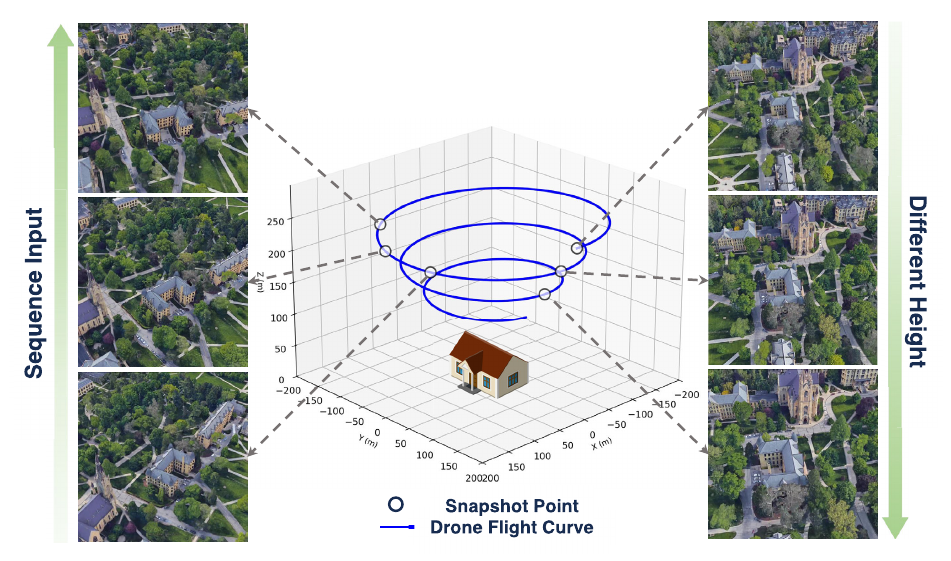
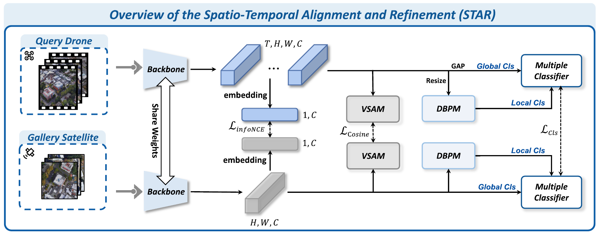

# STAR: Spatio-Temporal Alignment and Refinement for Cross-View Geo-Localization

**PyTorch implementation of our IEEE TGRS 2026 paper.**

Ziqian Mo, Yuxi Sun, Sen Jia, and Meng Xu<br>
*[STAR: Spatio-Temporal Alignment and Refinement for Cross-View Geo-Localization](https://doi.org/10.1109/TGRS.2026.3723684)*<br>
IEEE Transactions on Geoscience and Remote Sensing, vol. 64, 2026.

**[Paper](https://doi.org/10.1109/TGRS.2026.3723684) · [Model weights](#released-model-weights) · [Citation](#citation)**

## Overview

Cross-view geo-localization matches drone observations to satellite imagery. Adjacent frames along a drone flight provide complementary information about the same location, including changes in viewpoint, scale, and scene context. STAR learns from these temporal observations to improve cross-view feature alignment and refine spatial representations.



*Figure 1. Temporal observations and multi-height imagery in University-1652 motivate learning from drone sequences.*

## Method

STAR uses a shared ConvNeXt-B backbone for drone and satellite inputs, with three complementary training objectives:

1. **Global cross-view alignment** uses contrastive learning to bring corresponding drone and satellite representations together.
2. **ViViT Sequence Alignment Module (VSAM)** models spatial and temporal dependencies. Pseudo-Temporal Compensation (PTC) supports static satellite inputs within the temporal modeling branch.
3. **Dynamic Background Partitioning Module (DBPM)** adaptively partitions feature maps into foreground and background regions, with classification supervision refining global and local representations.



*Figure 2. STAR aligns drone sequences with satellite imagery through global contrastive learning, sequence alignment, and spatial refinement.*

Training pairs one satellite image with five consecutive drone frames. At inference, retrieval uses the backbone descriptors; the alignment and classification branches are used during training. Both single-image retrieval and sequence-query D2S retrieval are supported. Sequence evaluation averages frame descriptors before final normalization.

## Getting started

### Installation

Use Python 3.10-3.12. The code has been tested with Python 3.12, PyTorch 2.8.0, torchvision 0.23.0, and CUDA 12.6 on an NVIDIA L40S. Training is validated with CUDA mixed precision; evaluation supports CUDA and CPU.

After cloning or extracting this repository:

```bash
cd STAR
python3.12 -m venv .venv
source .venv/bin/activate
python -m pip install --upgrade pip

# CUDA 12.6; install matching PyTorch wheels first if using another platform.
python -m pip install torch==2.8.0 torchvision==0.23.0 --index-url https://download.pytorch.org/whl/cu126
python -m pip install -r requirements.txt
```

The image augmentations use the Albumentations 1.x API. Compatible versions are recorded in `requirements.txt`.

### Datasets

Download [University-1652](https://github.com/layumi/University1652-Baseline) and/or [SUES-200](https://github.com/Reza-Stu/SUES-200), then prepare the following layout:

```text
data/
├── U1652/
│   ├── train/{satellite,drone}/
│   └── test/{query_drone,gallery_satellite,query_satellite,gallery_drone}/
└── SUES-200/
    ├── train/{150,200,250,300}/{satellite,drone}/
    └── test/{150,200,250,300}/{query_drone,gallery_satellite,query_satellite,gallery_drone}/
```

Each view directory contains location-ID subdirectories. Datasets can remain outside the repository and be linked into `data/`, or be selected with `--data-folder`. Default paths resolve relative to the repository location. `UNIVERSITY1652_ROOT` and `SUES200_ROOT` provide alternative defaults.

For an extracted SUES-200 V2 dataset, generate the train/test layout with:

```bash
python tools/prepare_sues200.py \
  --destination /path/to/SUES-200-512x512 --split-only
```

This retains the raw images and creates directory links using the fixed 120-training-scene / 80-query-scene split in `star/dataset/splits/sues200.yaml`. Both datasets use numeric natural sorting for drone frames. See [Dataset preparation](docs/datasets.md) for complete layouts, download tools, and split details.

### Released model weights

Two checkpoint entries are reserved for this release. **Download links will be added here and in [`checkpoints/weights.json`](checkpoints/weights.json).**

| Checkpoint | Training dataset | Local checkpoint path | Download |
| --- | --- | --- | --- |
| STAR / University-1652 | University-1652 | `checkpoints/university1652/weights_e1_0.9535.pth` | Link to be added |
| STAR / SUES-200 150 m | SUES-200, 150 m | `checkpoints/sues200_150m/weights_e1_0.9728.pth` | Link to be added |

The manifest records the exact file size and SHA-256 of each checkpoint. Model weights are hosted separately from the source code. You can inspect the entries now:

```bash
python tools/download_weights.py --list
```

After the links are available, download and verify the selected weights:

```bash
python tools/download_weights.py --model university1652
python tools/download_weights.py --model sues200_150m
```

Manual downloads can be placed at the same paths and checked with these commands. See [Checkpoint instructions](checkpoints/README.md). The released STAR weights are separate from the ImageNet weights selected by `--pretrained` during training. Evaluation loads the STAR checkpoint directly.

## Training and evaluation

### Training

```bash
# University-1652, ImageNet initialization
python train_university.py --pretrained --direction D2S

# SUES-200, 150 m, ImageNet initialization
python train_sues200.py --pretrained --altitude 150 --direction D2S
```

For SUES-200, `--altitude` accepts 150, 200, 250, or 300. Training always pairs satellite images with drone sequences; `--direction` selects the validation protocol. Use `--no-pretrained` for random backbone initialization.

| Setting | University-1652 | SUES-200 |
| --- | --- | --- |
| Image size | 384 | 384 |
| Drone sequence length | 5 | 5 |
| Batch size | 16 | 16 |
| Epochs | 1 | 1 |
| Learning rate | 0.001 | 0.0006 |
| Script default for `pretrained` | `False` | `True` |

The commands above explicitly enable pretrained initialization for both experiments. The SUES-200 script defaults to 300 m; pass `--altitude 150` when training for the released 150 m setting.

Common overrides include `--data-folder`, `--device`, `--batch-size`, `--batch-size-eval`, `--epochs`, `--lr`, `--seed`, `--num-workers`, and `--output-dir`. `--checkpoint` / `--checkpoint-start` initializes model weights; it does not resume the optimizer, scheduler, or epoch counter.

Each run saves its resolved configuration, entry-script snapshot, log, and checkpoints under `outputs/<dataset>/<model>/<timestamp>/`. A limited pipeline check can be run with `--max-train-batches` and `--eval-max-images`; both default to 0, meaning the full dataset.

### Single-image evaluation

```bash
# University-1652, drone-to-satellite
python eval_university.py \
  --checkpoint checkpoints/university1652/weights_e1_0.9535.pth \
  --direction D2S --batch-size 32 \
  --output outputs/evaluation/university_D2S.json

# SUES-200, 150 m, drone-to-satellite
python eval_sues200.py \
  --checkpoint checkpoints/sues200_150m/weights_e1_0.9728.pth \
  --altitude 150 --direction D2S --batch-size 32 \
  --output outputs/evaluation/sues200_150m_D2S.json
```

Both single-image scripts support `--direction S2D` for satellite-to-drone retrieval. The same weights can be used for either direction on the corresponding dataset.

### Sequence-query evaluation

```bash
python eval_university_seq_D2S.py \
  --checkpoint checkpoints/university1652/weights_e1_0.9535.pth \
  --sequence-length 5

python eval_sues200_seq_D2S.py \
  --checkpoint checkpoints/sues200_150m/weights_e1_0.9728.pth \
  --altitude 150 --sequence-length 5
```

Sequence evaluation supports D2S retrieval. The default batch size is 8 for sequence queries and 64 for single images. Use `--batch-size` to fit available memory or `--device cpu` for CPU evaluation.

Evaluation reports Recall@1/5/10, Recall@top-1%, and mAP with the existing trapezoidal AP convention. Console values are percentages; JSON values are fractions. `--max-queries` and `--max-gallery` enable limited checks, which are marked in the JSON output. Default evaluation uses all available samples.

### Configuration

Each entry script exposes a `Configuration` class and a `config` object. For example, after `config = Configuration()` in `eval_sues200.py`:

```python
config.data_folder = "/path/to/SUES-200-512x512"
config.checkpoint_start = "checkpoints/sues200_150m/weights_e1_0.9728.pth"
config.altitude = 150
config.direction = "D2S"
```

Command-line options override Python configuration. Shared training settings are defined in `star/training.py`; evaluation settings are in `star/evaluate/cli.py`. Use each entry's `--help` for supported arguments.

## Repository structure

```text
STAR/
├── train_university.py / train_sues200.py
├── eval_*.py                    # Single-image and sequence-query evaluation
├── star/
│   ├── dataset/                 # Shared loaders, dataset interfaces, fixed split
│   ├── models/                  # ConvNeXt backbone, VSAM, DBPM
│   ├── loss/                    # Contrastive, alignment, classification losses
│   ├── evaluate/                # Feature extraction, checkpoint loading, metrics
│   ├── training.py              # Configuration and experiment setup
│   └── trainer.py               # Training epoch
├── checkpoints/                 # Weight manifest and download instructions
├── assets/                      # Paper figures used in this README
├── docs/
├── tools/
└── tests/
```

Datasets, model binaries, Python environments, credentials, and generated experiment outputs are excluded by `.gitignore`. Run the regression checks from the repository root:

```bash
python -m unittest discover -s tests -v
```

## Citation

If you use STAR in your research, please cite:

```bibtex
@article{mo2026star,
  title   = {{STAR}: Spatio-Temporal Alignment and Refinement for Cross-View Geo-Localization},
  author  = {Mo, Ziqian and Sun, Yuxi and Jia, Sen and Xu, Meng},
  journal = {IEEE Transactions on Geoscience and Remote Sensing},
  volume  = {64},
  year    = {2026},
  doi     = {10.1109/TGRS.2026.3723684}
}
```

## Acknowledgements

Parts of the training pipeline and data-loading code are adapted from [Sample4Geo](https://github.com/Skyy93/Sample4Geo). STAR uses [ConvNeXt](https://github.com/facebookresearch/ConvNeXt) and [`timm`](https://github.com/huggingface/pytorch-image-models). We thank the authors of these projects and the [University-1652](https://github.com/layumi/University1652-Baseline) and [SUES-200](https://github.com/Reza-Stu/SUES-200) datasets for making their work available. The upstream ConvNeXt [license](third_party/ConvNeXt-LICENSE) and source notices are retained.
